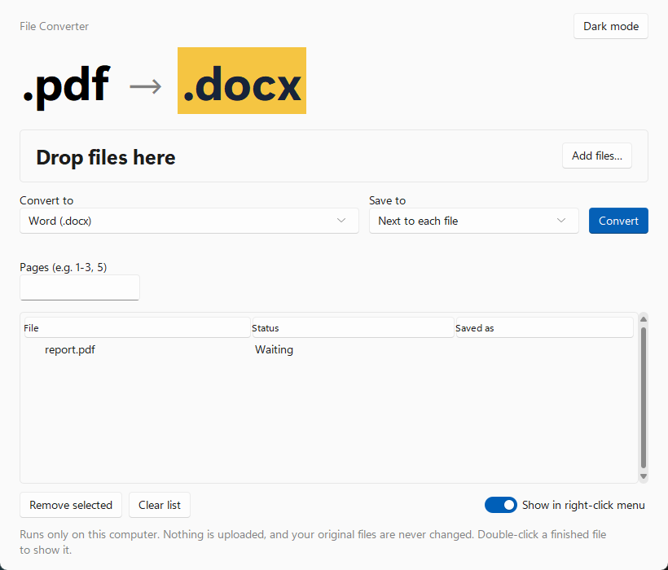
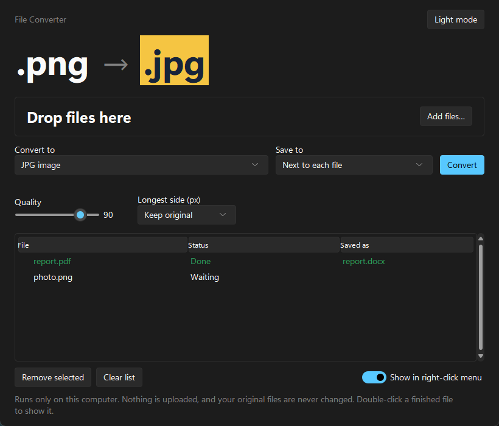

# File Converter

**Convert any file from the right-click menu in Windows 11. Fully offline.**

Right-click a file → **Convert with File Converter** → **PDF / DOCX / PPTX**. The converted file appears
next to the original. The app opens for anything else: images, audio, video, spreadsheets, OCR, merging PDFs.

No server, no internet, no uploads. Everything runs on your PC with free, open-source tools.



---

## Contents

1. [What it can do](#what-it-can-do)
2. [Install (5 minutes)](#install)
3. [Using it](#using-it)
4. [How it works (the tutorial part)](#how-it-works)
5. [Add your own conversion](#add-your-own-conversion)
6. [Troubleshooting](#troubleshooting)
7. [Uninstall](#uninstall)

---

## What it can do

| From | To |
|---|---|
| PDF | Word, PowerPoint (picture slides), text, HTML, PNG/JPG per page, split into pages |
| Several PDFs | One merged PDF |
| Word (DOCX, DOC, ODT, RTF) | PDF, PowerPoint, PNG/JPG per page, HTML, ODT, DOCX, text, Markdown |
| PowerPoint (PPTX, PPT, ODP) | PDF, PNG/JPG per slide |
| Excel (XLSX, XLS, ODS, CSV) | PDF, CSV, XLSX, HTML, JSON |
| Markdown, HTML, TXT | PDF, Word, HTML / Markdown |
| Images (PNG, JPG, WEBP, BMP, GIF, TIFF, HEIC, ICO) | Any of these, or PDF |
| Several images | One PDF |
| Video (MP4, MOV, AVI, MKV, WEBM) | MP4, WEBM, animated GIF, MP3 |
| Audio (MP3, WAV, M4A, OGG, FLAC) | Any of these |
| Scanned PDF or photo of text | Searchable PDF, or plain text (OCR) |

---

## Install

### 1. Install the converters

File Converter drives these free programs. Open **Terminal** and run:

```
winget install Python.Python.3.13
winget install TheDocumentFoundation.LibreOffice
winget install JohnMacFarlane.Pandoc
winget install Gyan.FFmpeg
winget install UB-Mannheim.TesseractOCR
```

You can skip any of the last four. The app turns off only the formats that need the missing program
and tells you how to install it.

### 2. Download File Converter

Click **Code → Download ZIP** above and unzip it somewhere **permanent**, for example `C:\Tools\File Converter`.
The right-click menu points to this folder. If you move it later, run `install.bat` again.

Or with git:

```
git clone https://github.com/Ahany1440/file-converter.git "C:\Tools\File Converter"
```

### 3. Turn on Developer Mode (for the Windows 11 menu)

**Settings → System → For developers → Developer Mode → On.**

Windows 11 only lets packaged apps into its new right-click menu. Developer Mode lets the included
menu package register without a paid code-signing certificate. Skip this step and the entry still
appears under **Show more options**.

### 4. Run `install.bat`

Double-click it. The first run takes a few minutes while it sets up Python packages. It adds:

- the right-click entry (new Windows 11 menu and the classic one),
- **File Converter** in the Start Menu,
- **Send to → File Converter**, which opens many files at once.

---

## Using it

**Right-click a file:**

```
Convert with File Converter  ▸   Open in File Converter…
                                 ───────────────
                                 PDF
                                 DOCX
                                 PPTX
```

The menu keeps to the three most-used formats, leaving out the file's own type. A small window shows
progress, then **Show in folder** / **Open**. **Open in File Converter…** opens the full app for every
other format.

**In the app:**

- Drag files or whole folders onto the window, or click **Add files…**.
- **Convert to** lists only the formats that work for every file you added.
- **Save to:** next to each file (the default), or a folder you pick.
- Extra settings appear only when they apply: page range, image quality and size, video height, OCR language.
- Double-click a finished file to show it in Explorer.



**Rules it always follows**

- Your original file is never changed. The app converts a temporary copy.
- Nothing is overwritten. If `report.docx` exists, you get `report (2).docx`.
- One file in, several out (a PDF page per image, a sheet per CSV)? They're saved together in a new folder, e.g. `report (png)`.
- A conversion that hangs is stopped after 10 minutes (60 for video).

---

## How it works

The project is small on purpose. Each piece is one file you can read in a few minutes.

```
right-click menu ──┐
Send To / Start ───┼──> gui.pyw ──> core.py ──> converters/ ──> LibreOffice, Pandoc, FFmpeg,
the app window ────┘                                           Tesseract, Python libraries
```

### 1. One conversion map — `converters/__init__.py`

Every conversion is one line:

```python
add(["pdf"], "docx", "Word (.docx)", "pdf_tools.to_docx")
add(WORD, "pdf", "PDF", "libreoffice.convert", needs=["soffice"])
```

That line says: *these input types* → *this output* → *label* → *which function does it* → *which program it needs*.
The app's format list, the right-click menu and the tests are all generated from this map, so adding
a conversion is one line.

Engines are named as text (`"module.function"`) and imported only when used, so the app starts fast.

### 2. The engines — `converters/*.py`

| File | Uses | Does |
|---|---|---|
| `libreoffice.py` | LibreOffice (`soffice --headless --convert-to`) | Office ↔ PDF |
| `pdf_tools.py` | PyMuPDF, pdf2docx, python-pptx | PDF → text, images, Word, slides; merge, split |
| `pandoc_tools.py` | Pandoc | Word/Markdown/HTML ↔ each other |
| `images.py` | Pillow + pillow-heif | all image formats |
| `sheets.py` | pandas + openpyxl | spreadsheets ↔ CSV / JSON / HTML |
| `media.py` | FFmpeg | audio and video |
| `ocr.py` | Tesseract | scans → searchable PDF / text |
| `tools.py` | — | finds those programs, even when they aren't on `PATH` |

### 3. Running safely — `core.py`

`core.convert()` does the careful parts, so the engines can stay simple:

1. Copies the input to a temporary folder. (LibreOffice leaves `~$file.docx` lock files next to whatever it opens.)
2. Runs the engine in a **separate process**, so a broken file can be killed at the time limit instead of freezing the app.
   On a timeout it kills the whole process tree, because `soffice.exe` starts a `soffice.bin` child.
3. Moves the result next to the original under a name that doesn't exist yet.

### 4. The window — `gui.pyw`

Tkinter with the [Sun Valley](https://github.com/rdbende/Sun-Valley-ttk-theme) theme for the Windows 11 look,
and tkinterdnd2 for drag and drop. Conversions run on a worker thread. Tkinter isn't thread-safe, so the thread
sends UI updates through a queue that the window reads (`UiQueue`).

`gui.pyw --convert pdf "C:\file.docx"` skips the window and shows only the small progress popup. That's what the
right-click menu runs.

### 5. The right-click menu — `shell.py` and `menu/`

Windows has two right-click menus, and each needs a different method:

- **Classic menu ("Show more options").** Plain registry keys under
  `HKEY_CURRENT_USER\Software\Classes\SystemFileAssociations\.<ext>\shell\FileConverter`, with a submenu per
  file type. No admin rights needed.
- **New Windows 11 menu.** Windows only accepts a COM object implementing `IExplorerCommand`, shipped in an
  app package. `menu/menu.cpp` is that object (~220 lines of C++). `AppxManifest.xml` is a *sparse package*
  that points Windows at it without moving any files. `install.bat` registers it with
  `Add-AppxPackage -Register AppxManifest.xml -ExternalLocation <folder>`, which works unsigned in Developer Mode.

The DLL contains no format list. It reads `menu/menu.txt`, which `shell.py` generates from the conversion map,
and runs the same `gui.pyw --convert …` command as the classic menu. Change the map, run `install.bat`,
and both menus update.

---

## Add your own conversion

Example: add **WEBP → AVIF** with Pillow.

1. Teach the engine the format, in `converters/images.py`:
   ```python
   PIL_FORMAT = {..., "avif": "AVIF"}
   ```
2. Add one line to the map, in `converters/__init__.py`:
   ```python
   add(IMAGES, "avif", "AVIF image", "images.convert")
   ```
3. Run the tests, which now include `webp->avif`:
   ```
   .venv\Scripts\python -m pytest tests
   ```

To show it in the right-click menu too, add `"avif"` to `BASICS` in `shell.py` and run `install.bat`.

---

## Troubleshooting

| Problem | Fix |
|---|---|
| Entry only under "Show more options" | Turn on Developer Mode, run `install.bat` again, then restart Explorer: `taskkill /f /im explorer.exe & start explorer.exe` |
| A format says *needs LibreOffice* (or another program) | Install it with the `winget` command the app shows, then restart the app |
| PDF → Word layout is off | Expected for complex layouts. A PDF stores positioned text, not paragraphs |
| PDF → PowerPoint text isn't editable | Pages become pictures on slides. Use PDF → Word to edit text |
| OCR reads only English | Add languages in the Tesseract installer, then type e.g. `ara` or `eng+ara` in **Text language** |
| Something failed | See `logs\converter.log` |

**Known limits:** animated GIF/WEBP keep only their first frame when converted to another image type.
Password-protected PDFs must be unlocked first. Word/PowerPoint → PDF uses the fonts installed on your PC.

---

## Uninstall

Run `uninstall.bat` (it removes both menus, Send To and the Start Menu entry), then delete the folder.

---

## For developers

```
.venv\Scripts\python -m pytest tests     # ~200 tests, about a minute
build_menu.bat                           # rebuild menu\FileConverterMenu.dll (needs MinGW g++)
build_exe.bat                            # optional standalone .exe (PyInstaller)
```

The tests generate a sample of every input format, run every conversion in the map, and open each result
with the matching library to prove it's valid. Conversions whose program isn't installed show as skipped, not passed.

## License

MIT
